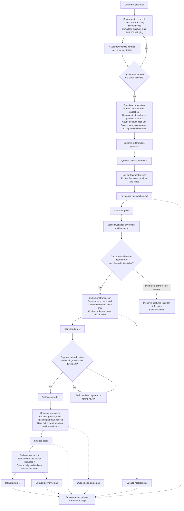
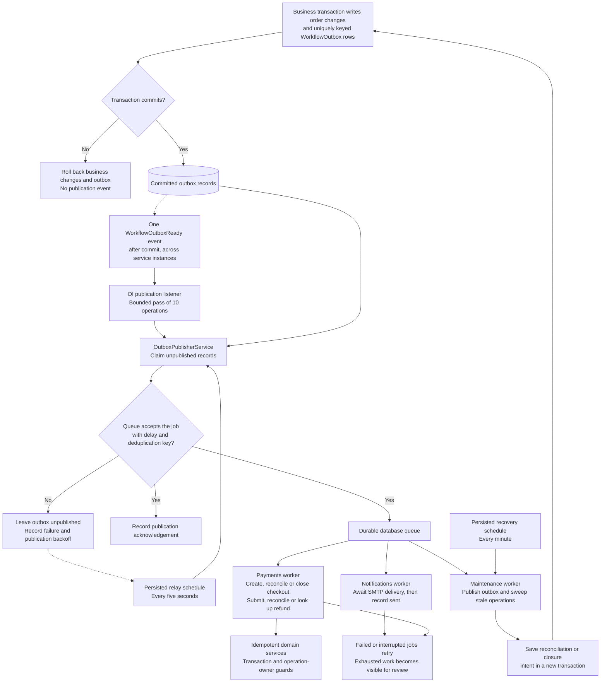
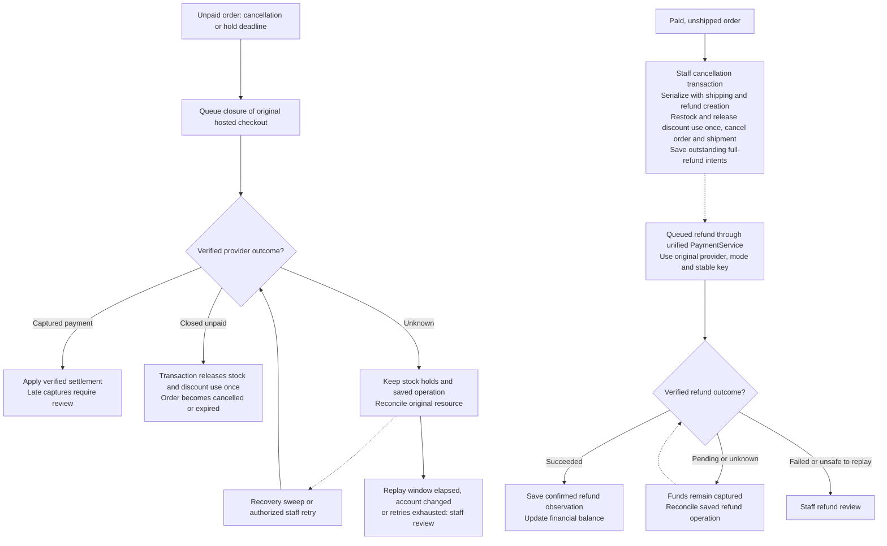

# Checkout process

This is the implemented flow for one shared store: guest checkout with an optional account, PHP prices, a frozen PHP 100 shipping fee, and one staff-managed shipment. Solid arrows show execution; dotted arrows show asynchronous triggers or status observations.

## Cart to shipment

The return page reads saved status; payment confirmation comes from a verified provider observation. Duplicate captures do not consume stock again. Mismatched totals, extra captures, or a payment arriving after stock release require review before fulfillment. Guest links use hashed capabilities; linking an optional account requires valid order access.

Delivery is a staff confirmation after dispatch, not a carrier integration. Only a shipped shipment moves to `delivered`; repeating the action returns the saved delivery without a second activity or email. A delivered order keeps every shipped-order guard, so it cannot be cancelled or refunded through these actions.

## Events and durable work

The event is an in-memory wake-up. A crash after commit or a listener failure leaves work in the outbox for the relay. A crash after queue acceptance but before the acknowledgement can publish a job again; domain guards make repeated execution safe. Notification delivery can repeat if SMTP accepts a message before its acknowledgement is lost.

## Cancellation and uncertain outcomes

Cancellation restores goods and requests refunds atomically; financial status changes only when refund success is confirmed. A refund requested without cancellation does not restock goods. Shipped and delivered orders cannot use these cancellation or refund actions. Pending refunds and unresolved payment/refund review block shipment.

See [payment contracts](../PAYMENTS.md), [operations and recovery](checkout-operations.md), and the [technical plan](plans/2026-10-03-cart-to-shipping.md).
