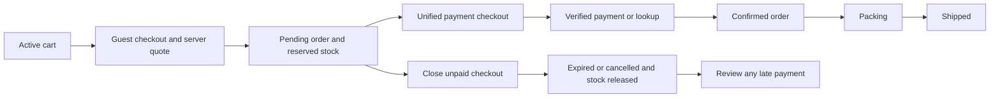

# Cart to shipping: technical implementation plan

Date: 2026-10-03, Asia/Manila. Status: implemented and verified locally; deployment configuration remains a launch gate.

Implement guest checkout, provider-neutral payment processing, inventory reservation, and staff fulfillment through shipment. Keep the database authoritative throughout browser redirects, webhooks, retries, and application restarts.

## Confirmed scope and proposed defaults

| Decision                           | Plan                                                                                                                                                                   |
| ---------------------------------- | ---------------------------------------------------------------------------------------------------------------------------------------------------------------------- |
| Store model                        | One shared store; customers, staff, and admins retain the existing authorization model.                                                                                |
| Checkout                           | Guests may pay. Signing in or creating an account is optional.                                                                                                         |
| Shipping price                     | **PHP 100 per order**, represented as **10,000 centavos**. Snapshot the fee when placing the order.                                                                    |
| Payment abstraction                | Application workflows use `PaymentService` and normalized results. Provider protocols remain inside adapters.                                                          |
| Validation                         | Vine validators under domain folders; no Zod in this feature.                                                                                                          |
| Background work                    | Use `@adonisjs/queue` with the Lucid database adapter initially; domain services remain responsible for business transitions.                                          |
| Currency                           | PHP for the first implementation.                                                                                                                                      |
| Stock hold                         | Proposed default: 15 minutes, configurable independently of cart expiry.                                                                                               |
| Fulfillment                        | Proposed v1: one shipment containing the whole order, manually prepared and dispatched by staff.                                                                       |
| Initial cancellation/refund policy | Proposed v1: customer cancellation before payment; staff cancellation/full refund before shipment. Overpayments and late payments have an explicit review/refund path. |
| Later scope                        | Partial shipments, returns, delivery confirmation, carrier APIs/labels, promotions, and partial-payment plans.                                                         |

Do not introduce an extra tax charge or discount rule. Preserve the existing monetary fields; define applicable pricing rules before enabling them. Shipping geography, the receipt-email transport, and operational carrier choices remain launch configuration decisions.

## Baseline before implementation

The following describes the original gaps this plan addressed. Current contracts and operating instructions are in [PAYMENTS.md](../../PAYMENTS.md) and [checkout operations](../checkout-operations.md).

- `app/services/checkout/cart_service.ts` supports session-owned carts and checks current stock when adding/updating lines. It does not reserve stock. Checkout must recheck availability and prices.
- The checkout migration already defines orders, item/address snapshots, nullable `user_id`, and a unique `orders.cart_id`. Keep these foundations and existing routes.
- Catalogue/cart/order prices currently use decimal **major units**, while `PaymentService` requires integer **minor units**. Establish one money conversion boundary.
- `PaymentService` is a runtime abstract DI contract, currently bound directly to `PayMongoService`. The adapter supports checkout creation/lookup/expiry, refunds, and asynchronous Vine-validated webhook parsing.
- The current contract routes lookups by external ID alone and has no refund lookup/event normalization. Extend it before supporting provider changes and asynchronous refund completion.
- `inertia/components/cart/Modal.vue` still has a checkout placeholder.
- The store order update endpoint accepts arbitrary `financialStatus` and `fulfillmentStatus`. Online payment and shipping transitions need explicit domain actions.
- The configured database is SQLite. Reservation and worker claims must work with conditional updates and short transactions; do not depend on row locks or `SKIP LOCKED`.
- `@adonisjs/queue` is not configured yet. Add its worker and scheduled recovery jobs alongside shipment records and mail integration.

## State model and XState decision

Use TypeScript state unions, explicit transition functions, domain guards, database constraints, and transition tests for v1. Persist scalar states, operation identifiers, deadlines, and versions. Controllers must call the domain service that owns a transition rather than updating status fields directly.

Keep these dimensions separate:

| Dimension        | States/meaning                                                                                                                                                                                                |
| ---------------- | ------------------------------------------------------------------------------------------------------------------------------------------------------------------------------------------------------------- |
| Cart             | `active -> submitted -> completed`; expired/cancelled submissions become `abandoned`. Submitted carts are immutable.                                                                                          |
| Order lifecycle  | `pending_payment -> confirmed`; or `expired`, `cancelled`, `review_required`. Exceptional paid outcomes may enter review from an expired/cancelled order.                                                     |
| Payment attempt  | `creating -> pending -> paid`; closure uses `closing -> expired`. Definite creation rejection is `failed`; ambiguous provider outcomes are `unknown` and require reconciliation.                              |
| Financial status | Preserve `pending`, `paid`, `partially_refunded`, `refunded`, `voided`; derive online order status from accepted payments and confirmed refunds. Do not use `authorized` for this capture-only checkout flow. |
| Reservation      | `reserved -> consumed` or `released`, exactly once.                                                                                                                                                           |
| Shipment         | `pending -> packing -> shipped`; pre-shipment cancellation is explicit.                                                                                                                                       |
| Refund operation | `requested -> pending -> succeeded/failed`; uncertain outcomes require reconciliation.                                                                                                                        |



**Defer XState.** Its guards and statecharts can express this model, but they do not remove the need for transaction boundaries, durable work, provider idempotency, or stock accounting. The current state dimensions have small transition tables, so an actor runtime and serialized actor snapshots add integration work without solving the main failure modes.

Reconsider XState when partial shipments, returns, warehouse allocation, or a branching checkout UI make the transition rules difficult to maintain. Its [pure transition functions](https://stately.ai/docs/pure-transitions) could then replace the transition evaluator while the database and services retain ownership of effects. [Parallel states](https://stately.ai/docs/parallel-states) can represent independent concerns. If actors are introduced, account for [snapshot compatibility and restarted invocations](https://stately.ai/docs/persistence); keep payment calls idempotent and deadlines durable.

## Provider-neutral payment boundary

Keep `PaymentService` as the injected application contract. Bind it to a small dispatcher with registered adapters and a configured default provider. Use the current PayMongo adapter as the first implementation; no second provider is required to ship v1.

Proposed reference type:

```ts
type PaymentReference = { provider: string; id: string }
```

- `createCheckout(input)` uses the configured default and returns the provider plus opaque checkout ID, URL, normalized status, and payments.
- `getCheckout(reference)` and `expireCheckout(reference, key)` resolve the provider saved on the attempt.
- `refund(input)` receives an opaque payment reference and a stable operation key.
- Add `getRefund(reference)` and a normalized `refund.updated` event, so pending refunds can be resolved through a webhook or a lookup.
- `parseWebhook({ provider, rawBody, headers })` selects an allowlisted adapter and returns normalized events. Signature verification and external event names remain adapter responsibilities.
- Normalize operation errors as `not_submitted`, `rejected`, or `unknown`, with a retryable flag and sanitized code. Transport timeouts default to unknown. Provider HTTP status is diagnostic data; recovery services must not interpret vendor status codes to decide whether money moved.

The dispatcher alone chooses adapters. Checkout, settlement, inventory, and fulfillment services must contain no provider-specific branches, ID-prefix parsing, API field names, signature logic, or payment-method codes. Keep adapters for old attempts configured when changing the default provider; refunds and recovery must still reach the original provider.

Use normalized facts such as `checkout.paid`, `pending`, `expired`, and `refund.updated`. Verification of amount, order association, and stock remains an application responsibility.

## Persistence and invariants

Add migrations and Lucid models in their owning domains. Generate `database/schema.ts` through the framework; do not edit it manually.

| Record              | Required additions/data                                                                                                                                                                                                    |
| ------------------- | -------------------------------------------------------------------------------------------------------------------------------------------------------------------------------------------------------------------------- |
| Carts               | `version`; guarded status transitions and a server-issued submission key.                                                                                                                                                  |
| Orders              | Lifecycle state, `source` (`legacy`/`online`), unique submission key, version, `paid_at`, review reason, and canonical minor-unit totals for online orders. Retain the existing cart association and historical snapshots. |
| Order line items    | Canonical integer unit price, discount, and line total for online snapshots. Existing decimal fields remain checked compatibility projections.                                                                             |
| Payment attempts    | Public local UUID, order FK, provider, expected amount/currency/mode, status, immutable request snapshot, unique idempotency key, nullable external checkout ID/URL, expiry, retry/error metadata, and operation version.  |
| Payments            | Attempt/order FKs, provider payment ID, actual amount/currency/mode, capture time, and disposition (`accepted`, `overpayment`, `review_required`). Unique `(provider, mode, external_payment_id)`.                         |
| Product variants    | `inventory_reserved_quantity`, initially zero. Keep `inventory_quantity` as on-hand stock.                                                                                                                                 |
| Stock reservations  | Order/variant, quantity, expiry, state, and settlement timestamps. Unique `(order_id, variant_id)` after combining quantities by variant.                                                                                  |
| Shipments           | Unique order FK for v1, state, carrier, tracking number/URL, packing/shipped timestamps, and staff actor.                                                                                                                  |
| Refund operations   | Payment/order, amount/currency, stable idempotency key, external refund ID, normalized status, reason, staff actor, and reconciliation metadata.                                                                           |
| Order access grants | Order, hash of a random guest token, expiry/revocation, and narrowly scoped access. Never use a guessable order number as authorization.                                                                                   |
| Workflow outbox     | Unique operation key, operation type and entity IDs, publication availability/attempt metadata, short publisher lease, published time/job reference, and sanitized publication error. Queue owns execution retries.        |
| Queue storage       | Package-managed job and schedule tables, created through the queue installer/schema service. Keep these distinct from payment facts and order activity.                                                                    |
| Order activity      | Actor/source, event, from/to states, entity references, and time for payment, cancellation, refund, and shipping actions.                                                                                                  |

Uniqueness for checkout IDs and refund IDs must include provider/mode. Enforce one usable checkout session per order at a time through a transaction and version/claim guards. Close and reconcile an existing session before replacing it.

Use integer columns and constraints for minor amounts, positive quantities, and nonnegative stock counters. For tracked inventory, reserved quantity must not exceed on-hand quantity. Application arithmetic also enforces JavaScript safe-integer limits. Keep provider request snapshots immutable and version state mutations.

Backfill legacy order lifecycle from existing financial/cancellation data without inventing provider payments, reservations, or shipment tracking. Preserve historical amounts and fulfillment values. Restrict new automatic workers to online orders and explicitly scheduled operations. Disable provider refunds when no captured provider payment exists.

### Money and shipping

Calculate quotes, snapshots, expected payment amounts, refunds, and comparisons in safe integer centavos. Configure the flat fee as `flatShippingAmountMinor: 10_000` in store checkout configuration. It applies once to a non-empty physical order, independently of item count or payment retries.

Use a shared exact decimal-to-minor conversion helper and validate new PHP catalogue prices to at most two decimal places. Audit existing prices before enabling checkout; reject unsupported precision rather than silently rounding it. Use checked integer arithmetic for every line and sum.

For two PHP 499 shirts: `2 * 49_900 + 10_000 = 109_800` centavos. Persist the order's shipping snapshot as PHP 100 in the existing compatibility field. Send shipping through the unified checkout input as an ordinary shipping line item. All attempts for that order use the same frozen total even if the store fee later changes.

## Application services

Default-export service classes under domain folders; consumers use constructor `@inject()` and runtime imports. Services receive explicit domain data rather than `HttpContext`.

| Service                            | Responsibility                                                                                                               |
| ---------------------------------- | ---------------------------------------------------------------------------------------------------------------------------- |
| `checkout/quote_service.ts`        | Reload sellable variants, convert prices, calculate shipping/totals, and detect changes to a displayed quote.                |
| `checkout/checkout_service.ts`     | Authorize cart access, freeze the submitted order, reserve stock, save a payment attempt, and record checkout creation work. |
| `catalog/inventory_service.ts`     | Atomic reserve/consume/release operations and available-stock queries.                                                       |
| `payments/payment_service.ts`      | Unified provider contract and dispatcher/adapters.                                                                           |
| `payments/settlement_service.ts`   | Apply normalized payment observations exactly once and derive financial status.                                              |
| `payments/recovery_service.ts`     | Reconcile unknown/stale attempts, close abandoned sessions, and recover provider outcomes.                                   |
| `payments/refund_service.ts`       | Authorize/request refunds, reserve refundable balance, and apply confirmed refund outcomes.                                  |
| `checkout/order_access_service.ts` | Guest capabilities, customer ownership, and verified account linking.                                                        |
| `checkout/fulfillment_service.ts`  | Guard packing/shipping/cancellation, write shipment records, and append activity/outbox work.                                |

Keep transition decisions explicit and testable. Make database mutations and outbox inserts in the same transaction; make external calls after commit.

Jobs under `app/jobs/checkout` and `app/jobs/payments` use constructor injection to call these services. Jobs receive local operation/entity IDs, reload saved state, and delegate business decisions. They do not import the PayMongo adapter or duplicate settlement/inventory rules.

## Checkout and payment workflows

### Quote and submission

1. `GET /checkout` loads the session-owned active cart and current product prices, and supplies a server quote, cart version, and submission key. This page does not hold inventory.
2. `POST /checkout` uses Vine for contact/shipping/billing input. It resolves the cart from trusted session context, checks any account/address association, and recalculates the quote. Changed prices or cart contents require the customer to review the updated quote before proceeding.
3. In one short transaction, conditionally claim the cart version, create the immutable pending order and snapshots, reserve stock, save the attempt and its stable request/key, and insert checkout creation into the outbox. Roll back all writes if any variant cannot be reserved.
4. Repeated submission with the same key and payload returns the same authorized order/attempt. Reuse with a different payload returns a conflict. Unique cart/submission constraints handle simultaneous requests.
5. Freeze the submitted cart and rotate the active shopping-cart token. Keep the order access grant separately so repeated submissions and payment returns still reach the existing order.
6. After commit, publish the outbox operation to `CreateCheckout`. Return the authorized order-status page while the worker uses the persisted request/key to create checkout. Save the returned reference before exposing the redirect URL. An already-paid result goes through settlement immediately. A dispatch failure leaves durable work for the outbox relay to recover; still return the committed order's waiting page.

The frontend never supplies authoritative amounts or freely selects a provider. Failed card/wallet tries inside a still-usable hosted session reuse its URL. Changed items/addresses after submission require closing the old checkout and starting a fresh snapshot.

### Settlement and customer return

1. Webhook ingress passes the raw body to the selected adapter; the adapter verifies authenticity before producing normalized events. The specific external route receives a CSRF exemption, not the customer checkout routes.
2. Resolve the saved local attempt and verify provider, mode, checkout/payment association, merchant reference, currency, and amount. Correlation metadata may help find an attempt but does not authorize fulfillment by itself.
3. In a transaction, insert a unique payment observation, validate the current order/reservation versions, consume reserved inventory, mark the attempt paid and the order confirmed/paid, and append activity plus a uniquely keyed confirmation notification.
4. A repeated observation of the same payment is a no-op. A second distinct payment is recorded as an overpayment for review/refund; it does not consume stock or confirm the order again.
5. The customer return/status page reads stored state. An authorized return may request a deduplicated reconciliation job when a webhook has not arrived; its server lookup feeds the same settlement service. Browser parameters never mark an order paid.

Persist valid but unmatched/mismatched payment observations for review without accepting them as order credit or allowing shipment. Invalid signatures and malformed payloads produce no business mutations. Acknowledge a relevant webhook only after durable processing; transient database failures allow redelivery. Verified ignored events can be acknowledged directly. Modern envelopes without event IDs are deduplicated through payment/refund resource IDs and unique operation keys.

### Reservation expiry and recovery

Store deadlines in the database. Dispatch a delayed `ExpireCheckout` job for the deadline and schedule `SweepPaymentOperations` every minute to recover missed jobs and overdue attempts. Both read the current stored deadline/status; a delayed job firing after payment is a no-op. Delays improve responsiveness, while the sweep recovers downtime. Do not use browser timers or process-local timers as the expiry mechanism.

At the deadline, claim the attempt for closure. Query/close the checkout through `PaymentService` outside a database transaction. Apply any paid observation before deciding to release stock. Release once after confirmed closure; an unavailable provider or ambiguous outcome leaves the attempt recoverable and raises a stale-operation alert.

Closure can race with an in-flight payment. A late payment after stock release is still recorded. If the order was expired, attempt an atomic stock reacquisition when policy permits; confirm only if all stock is available. A deliberately cancelled order or unavailable stock goes to review/refund rather than automatic fulfillment.

PayMongo currently requires explicit session expiry; its adapter implements the unified close operation. This protocol detail does not enter order or inventory services. See the provider's [session lifecycle](https://docs.paymongo.com/docs/payment-channels-key-concepts).

Recover crashes after provider success but before local persistence by replaying the saved request with the same key or fetching the known resource. Preserve the distinction between definite failure and unknown outcome. Reconciliation and webhook delivery must remain safe in either order.

## Inventory semantics

For tracked variants, available stock is `inventory_quantity - inventory_reserved_quantity`. Reserve with a conditional database update requiring sufficient availability, then insert the reservation in the same transaction. Combine all quantities for the same variant first.

- Reserve: increase reserved quantity; leave on-hand quantity unchanged.
- Consume: decrease on-hand and reserved quantities together; transition the reservation from reserved to consumed once.
- Release: decrease reserved quantity only; transition from reserved to released once.
- Null inventory means untracked inventory and does not use finite stock counters.

Update catalogue availability, cart checks, and staff inventory writes to respect reservations. Reject a staff stock reduction below outstanding holds and prevent deletion of products/variants with active reservations. Prevent changes to inventory tracking mode while relevant pending checkouts exist. Cancellation of a paid, unshipped order restocks consumed items once through an explicit inventory action; a refund alone does not imply returned inventory.

## Guest access, refunds, and shipping

Guest access tokens are random, hashed at rest, scoped, revocable, and expired by policy. Prefer exchanging a receipt-link token for session access and redirecting to a clean URL. Omit capabilities from logs, public props, and tracking links. Numeric order IDs and matching an email string never grant access.

Signed-in account routes retain ownership checks for every role. Staff/admin use store policies for shared order management. Optional account linking requires verified ownership through authentication/email proof and the guest order grant; do not attach every order whose email matches an unverified account.

Replace the online order's financial-status selector and arbitrary fulfillment edits with explicit cancellation, refund, packing, and shipping actions. Derive frontend permissions from Bouncer policy checks. Retain legacy route names and a clearly scoped legacy-management path without manufacturing gateway records.

For a refund, persist the operation, reserve its amount against captured funds including pending refund operations, and insert refund work in the same transaction. `SubmitRefund` claims the operation and calls `PaymentService` after commit, routing to the original provider. Change refunded totals only after confirmed success; pending responses remain pending and are reconciled through `getRefund` or normalized events. Full refunds for cancelled, unshipped v1 orders include the PHP 100 shipping fee. Staff actions and failures remain auditable.

Packing/shipping requires an online order that is confirmed, paid, has consumed/reacquired stock, and has no cancellation or blocking review. Cancelled/refunded orders cannot ship. A shipping action records carrier, tracking information, ship time, and actor, sets the existing fulfillment projection to `fulfilled`, and queues a shipment notification. Validate tracking URLs as HTTP(S). For v1, `fulfilled` means dispatched; delivery confirmation is a future workflow. Historical partial fulfillment remains readable.

## HTTP and frontend integration

Proposed resource routes (preserve all current URLs and named routes):

| Route                                              | Controller action/purpose                                                                |
| -------------------------------------------------- | ---------------------------------------------------------------------------------------- |
| `GET /checkout`                                    | `checkout/checkout_controller.create`: guest details, server quote, review.              |
| `POST /checkout`                                   | `checkout/checkout_controller.store`: idempotent order submission.                       |
| `GET /checkout/orders/:publicId`                   | `checkout/orders_controller.show`: authorized payment/order status.                      |
| `POST /checkout/orders/:publicId/payment-attempts` | `checkout/payment_attempts_controller.store`: resume or safely replace a closed attempt. |
| `POST /checkout/orders/:publicId/cancellation`     | `checkout/cancellations_controller.store`: request closure of an unpaid order.           |
| `POST /webhooks/payments/:provider`                | `payments/webhooks_controller.store`: allowlisted adapter ingress.                       |
| `POST /seller/orders/:id/packing`                  | `seller/packing_controller.store`: begin preparation.                                    |
| `POST /seller/orders/:id/shipments`                | `seller/shipments_controller.store`: dispatch the order.                                 |
| `POST /seller/orders/:id/refunds`                  | `seller/refunds_controller.store`: explicit authorized refund.                           |
| `POST /seller/orders/:id/cancellation`             | `seller/cancellations_controller.store`: guarded store cancellation.                     |

Add focused checkout and order-status Vue pages using existing Nuxt UI components and the current theme. Replace the cart placeholder with typed Inertia navigation. Use the existing `<Form>`/`useForm` patterns, Vine errors, flash, and generated transformer/page types.

Show the PHP 100 shipping charge before submission. Cover price changes, out-of-stock items, checkout creation/recovery, waiting for payment, payment retry, expiry, confirmation, cancellation, and review. Any countdown is informational and based on a server deadline. Poll status only while necessary, stop on terminal outcomes/unmount, and do not issue unrestricted provider API calls on every poll.

The account order page and guest page should share the safe order presentation, while their authorization entry points remain distinct. Store pages show payment history, reservations, review alerts, shipment tracking, and permitted actions; they never expose secrets or raw provider payloads.

## Durable work with AdonisJS Queue

Adopt `@adonisjs/queue` for job execution. The [official queue guide](https://docs.adonisjs.com/guides/digging-deeper/queues) documents a Lucid adapter compatible with SQLite, delayed jobs, retries, schedules, and test fakes. The package is experimental; pin an exact compatible release and commit its lockfile during implementation.

### Driver and integration

Use the database adapter against the existing `sqlite` connection for initial development and a single-host v1 deployment. Keep the database on persistent storage accessible to both web and worker processes. Adonis recommends Redis for production; choose it when deployment needs independent hosts or measured queue load warrants it. This changes queue configuration without changing payment services. Use the database adapter for recovery tests; sync execution cannot establish durable-worker behavior.

During implementation, run the framework installer, select the database driver, and review its provider/command registrations, `config/queue.ts`, environment validation, queue-table migration, and `start/scheduler.ts`. Use the current `Job`/`execute()` API with `static options` and typed payloads. Start with one worker at concurrency 1 while SQLite contention and payment races are verified.

### Transactional publication

Keep a small transactional outbox. The documented dispatch API does not establish participation in the caller's Lucid transaction; using the same database does not establish that guarantee either. Dispatching only after commit can lose work if the process dies between those steps. Do not enqueue before commit or manually insert into package-owned queue tables.

Write domain changes and the uniquely keyed outbox record together. After commit, the publisher claims a bounded batch in a short transaction, dispatches known job types outside that transaction, and marks a row published only after successful queue acceptance. A scheduled `PublishWorkflowOutbox` job recovers unpublished rows and expired publisher claims. If it crashes after dispatch but before marking publication, replay can enqueue duplicate execution; domain idempotency makes this safe. Queue deduplication reduces duplicates but does not prove exactly-once side effects.

The outbox tracks publication only. Adonis Queue owns execution retries, backoff, delays, heartbeats, stalled-job recovery, and job history. Business records retain operation claims/versions needed to guard concurrent payment mutations. Remove the proposed custom `checkout:work` runner. A one-pass outbox publication/repair Ace command may call the same publisher for operations; it must not become a second job executor.

### Job responsibilities

| Job                                | Work                                                                                  | Domain owner                          |
| ---------------------------------- | ------------------------------------------------------------------------------------- | ------------------------------------- |
| `PublishWorkflowOutbox`            | Publish committed work in bounded batches; scheduled with a stable ID.                | Outbox publisher                      |
| `CreateCheckout`                   | Load the frozen attempt and create/resume its checkout.                               | Checkout service and `PaymentService` |
| `ReconcileCheckout`                | Resolve stale/unknown outcomes through normalized lookup.                             | Recovery and settlement services      |
| `ExpireCheckout`                   | Close an unpaid session at its stored deadline before releasing stock.                | Recovery and inventory services       |
| `SweepPaymentOperations`           | Discover overdue/stale attempts and refund operations; request guarded recovery work. | Recovery service                      |
| `SubmitRefund` / `ReconcileRefund` | Execute a saved refund and confirm its eventual result.                               | Refund service and `PaymentService`   |
| `SendOrderNotification`            | Deliver the saved receipt or shipment notification.                                   | Notification service                  |

Keep verified webhook settlement in a short database transaction and acknowledge after durable processing. Queue external lookups, refunds, and notifications; accepting a webhook never waits for an email or provider API call. Job payloads carry operation/entity IDs, not mutable cart data, secrets, guest tokens, or raw provider payloads.

### Retries, scheduling, and operations

Separate logical `maintenance`, `payments`, and `notifications` queues. Define stable schedule IDs in `start/scheduler.ts`: publish outbox work every few seconds and sweep payment operations every minute. Scheduled invocations may overlap, so publisher claims and domain guards still apply. Register schedules against the selected durable adapter and verify their execution with the pinned release.

Configure bounded retries with exponential backoff/jitter, execution and provider-request timeouts, stalled-job recovery, graceful shutdown, and bounded completed/failed retention. A timeout is an unknown payment outcome, not evidence of failure; reconciliation must use the saved reference/key before attempting another money mutation. Cooperative cancellation and operation-version checks protect against an original handler finishing after retry starts. `failed()` records/alerts an unresolved operation; it must not void payment or release stock solely because queue retries ended. Failed retained jobs need an explicit retry/review path; avoid a sweeper endlessly creating new retries after exhaustion.

Run `node ace queue:work --queue=maintenance,payments,notifications --concurrency=1` alongside the web process under a process supervisor. All named queues must be serviced; verify scheduled publication, deadline sweep, and restart recovery at deployment. Queue latency can delay closure beyond the 15-minute target, so show the stored deadline without promising immediate stock release.

Configure a mail transport for guest receipts and shipping notifications during launch preparation. Record uniquely keyed notification work in the settlement/shipping transaction. Notification failure never reverses payment or shipment. A mail transport may accept a send before the worker crashes; record delivery status and use transport idempotency where available, while acknowledging that delivery can repeat.

Monitor unpublished outbox age, queue depth/age, failed/stalled jobs, stale creating/unknown/closing attempts, unresolved paid events, overpayments, stuck refunds, inventory counters, and notification failures. Provide authorized staff review actions; preserve captured-payment facts even when fulfillment needs intervention.

## Implementation sequence and completion gates

| Phase                      | Work                                                                                                                                                                                                  | Completion gate                                                                                                              |
| -------------------------- | ----------------------------------------------------------------------------------------------------------------------------------------------------------------------------------------------------- | ---------------------------------------------------------------------------------------------------------------------------- |
| 1. Contracts and rules     | Establish state unions/transitions, exact money rules, PHP 100 configuration, provider references/dispatcher, and refund lookup/events. Update the current adapter and fake contract.                 | Provider-neutral unit tests and existing adapter tests pass; domain services need no provider-specific imports.              |
| 2. Persistence and stock   | Add migrations/models, legacy backfill, snapshots, reservations/counters, access grants, outbox/activity records, and cart guards. Configure pinned Adonis Queue, its database tables, and publisher. | Real SQLite tests prove rollback, stock claims, cart freezing, consume/release, and recoverable publication after commit.    |
| 3. Checkout and settlement | Implement quote, guest submission/access, thin checkout/recovery jobs, normalized webhook/lookup settlement, delayed expiry, and scheduled recovery.                                                  | Duplicate submission, publication/worker crash, timeout, webhook race, late-payment, and provider-switch scenarios pass.     |
| 4. Customer experience     | Wire cart navigation, checkout/review, payment return/status, guest receipt access, and account linking.                                                                                              | Browser tests cover guest and signed-in flows, changed quotes, retries, expiry, and private-order access.                    |
| 5. Store fulfillment       | Replace online status selectors; add packing, shipment tracking, cancellation/full refunds, review history, and notifications.                                                                        | Unpaid/cancelled/review orders cannot ship; successful dispatch/refund actions produce consistent records and notifications. |
| 6. Operational readiness   | Configure mail, supervised queue worker, persisted schedules, failed-job review/retry, provider secrets/webhooks, alerts, audits, and deployment instructions.                                        | Test-mode payment/recovery exercises pass without live charges; all queues/schedules, transports, and restart recovery work. |

During implementation use the AdonisJS, Lucid, Japa, Inertia Vue, and Nuxt UI project skills for their respective layers. Keep the existing dev server running while source controllers/routes/transformers change; allow codegen to regenerate `database/schema.ts` and `.adonisjs` outputs through the documented paths. Do not edit generated files by hand.

## Verification matrix

- Money: PHP 499 x 2 + PHP 100 yields 109,800 centavos; one fee across retries; exact conversion; unsupported precision, overflow, and mixed currency rejected.
- Checkout: anonymous checkout, authenticated ownership, optional account claim, empty/stale cart, changed quote, address tampering, concurrent/different-payload submission, and cart-token rotation.
- Inventory: two buyers competing for the final unit; multi-variant rollback; untracked stock; staff writes during holds; repeat consume/release/restock; product deletion protection.
- Payments: invalid signatures/modes, unknown references, mismatched totals, duplicate/out-of-order notifications, failed internal payment retries, overpayment, and payment without a browser return.
- Recovery: crashes before/after remote calls, replay with the same request/key, missed webhook, provider outage during closure, stale operation/publisher claims, and late payment after inventory release.
- Queue publication: transaction rollback leaves no outbox work; a crash after commit still dispatches; a crash after dispatch replays safely; queue unavailability preserves unpublished rows. Use `QueueManager.fake()` for dispatch assertions and restore it after each test.
- Queue execution: real database-adapter tests cover worker restart/stalled-job recovery, retry exhaustion and explicit retry, overlapping schedules, delayed expiry after payment, and job timeout while an earlier handler is still returning. Fakes/sync are insufficient for these guarantees.
- Provider neutrality: run checkout/settlement tests with a second fake adapter using different ID formats and event payloads; changing the default still routes old lookups/refunds correctly.
- Fulfillment/refunds: unpaid or cancelled shipping blocked, concurrent shipping/cancellation/refund guards, repeat shipment, pending versus successful refund, and no double restocking.
- Notifications: one logical receipt/shipping operation per business event, safe duplicate queue execution, retry without repeating settlement, and documented mail-delivery ambiguity.
- Compatibility: legacy orders/URLs, staff shared access, customer account ownership, existing payment adapter tests, unit/functional suites, targeted browser tests, typecheck, lint, and a production build before release.

The acceptance outcome is a guest customer paying a frozen PHP order plus PHP 100 shipping, with inventory reserved/consumed safely, a recoverable payment record, a private order page, and an authorized staff member dispatching it with tracking. Provider choice changes only adapter registration and configuration, and XState remains an optional future transition evaluator.

## Implementation record

| Phase                      | Result                                                                                                                                                                                                                                                                                                                                                                    |
| -------------------------- | ------------------------------------------------------------------------------------------------------------------------------------------------------------------------------------------------------------------------------------------------------------------------------------------------------------------------------------------------------------------------- |
| 1. Contracts and rules     | Implemented exact minor-unit money, PHP 100 shipping, explicit states, a DI dispatcher, provider/mode references, conservative replay windows and normalized refund events. XState remains deferred.                                                                                                                                                                      |
| 2. Persistence and stock   | Applied five workflow/queue migrations locally and generated schema models. Added guarded reservations, snapshots, grants, outbox/activity and stock-aware catalogue/cart handling, including existing carts without submission keys.                                                                                                                                     |
| 3. Checkout and settlement | Implemented transactional guest submission, webhook settlement, queued creation/recovery/closure/refunds, sparse refund lookup and stable schedules. Real SQLite/queue tests cover lost responses, publisher crashes, stalled workers, timeout with a late handler, delayed expiry, schedule overlap and explicit recovery.                                               |
| 4. Customer experience     | Implemented cart checkout navigation, Vine-backed addresses, frozen quote review, private payment/status/tracking pages, guest receipt access and capability-backed account claiming. Browser checks cover guest and signed-in checkout, stale quote recovery, hosted-payment links and automatic payment status refresh.                                                 |
| 5. Store fulfillment       | Implemented staff packing/shipping, tracking, guarded cancellation and full refunds, operation/notification retries and activity history. Online financial/fulfillment status cannot be changed through the legacy selectors.                                                                                                                                             |
| 6. Operational readiness   | Implemented SMTP notifications, bounded retry/failed retention, read-only audit, one-pass publication and refund-lookup recovery commands. The actual Ace worker processed both persisted schedules against an empty development workflow database. Supervisor, real credentials/webhook setup, SMTP delivery and monitoring integration remain deployment configuration. |

Verification: 90 unit/functional tests and all 14 browser tests passed; type checking, lint for changed files and a production build passed. Existing unrelated Inbox components still have eight repository-wide lint errors. See [checkout operations](../checkout-operations.md) for commands and launch checks. Tests used fake payment/mail transports and signed fixtures, with no live charges or customer messages.

The development server stays running during source/codegen work. The temporary worker used to verify startup/schedules was stopped after verification; production must supervise its own worker servicing all three queues.

Follow-up: transactions that record outbox work now dispatch one `WorkflowOutboxReady` event after commit. A DI listener publishes promptly across web, worker and console environments; the five-second relay remains the recovery path. Eight controllers no longer depend on the publisher. All 93 unit/functional tests and both focused checkout browser tests passed, along with type checking, changed-file lint and a production build. See the [process graph](../checkout-process.md) for the implemented flow.
